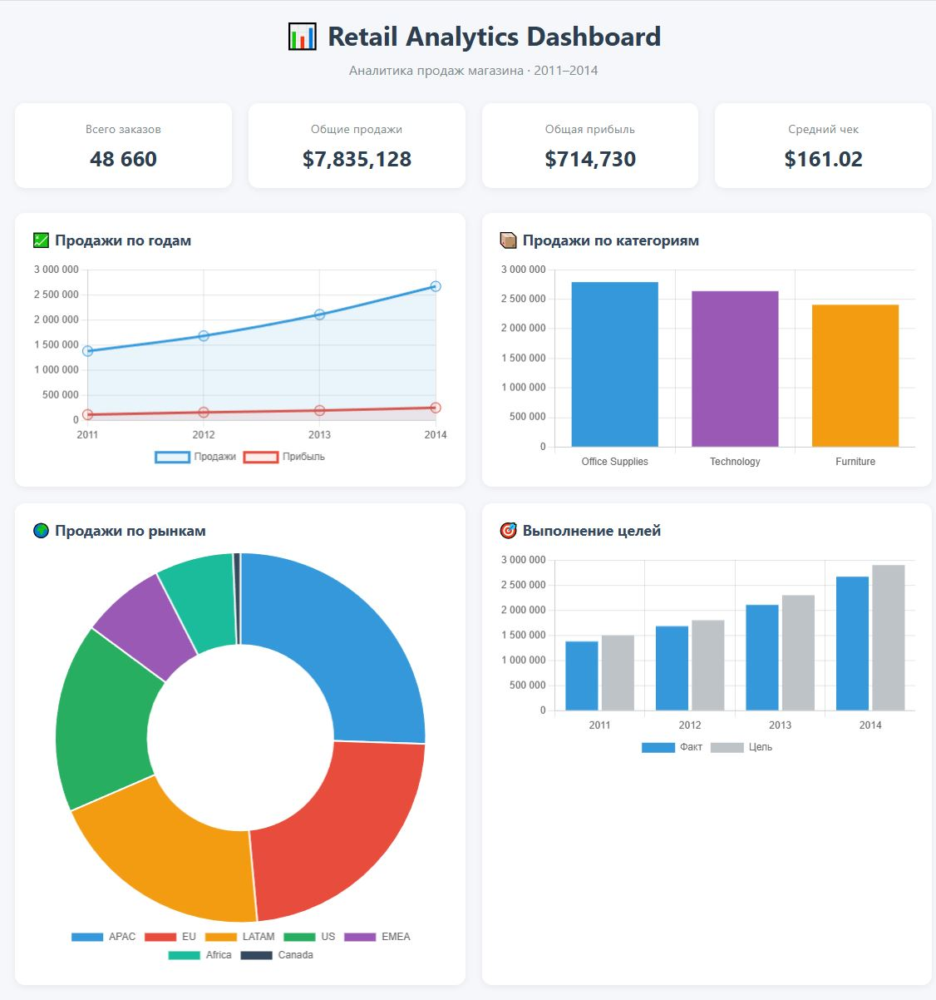

# 📊 Retail Analytics Dashboard

Аналитический проект для анализа продаж магазина: 
от сырых данных до интерактивного дашборда.

## 🎯 Что внутри

- **Анализ данных** — pandas, numpy, matplotlib, seaborn
- **SQL-запросы** — JOIN, оконные функции, накопительные итоги
- **База данных** — SQLite
- **API** — FastAPI с 6 эндпоинтами
- **Дашборд** — HTML + Chart.js
- **Docker** — запуск одной командой

## 📸 Скриншот



## 🚀 Быстрый старт

### Через Docker (рекомендуется)

```bash
docker-compose up --build